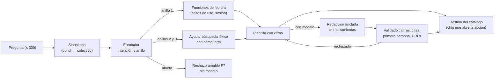

# El asistente de Movilidad Urbana

Un asistente completo, de punta a punta, dentro de `MovilidadUrbana.Web`: es el ejemplo trabajado de la
guía [Dot-Net-Integration-AI-Layer-Guide](https://github.com/hdcm-dev/Lab-Documentos/tree/main/Guides/IA/Dot-Net-Integration-AI-Layer-Guide)
y de sus conocimientos para agentes. La regla que lo ordena todo: **el código elige, el modelo redacta**.
Las cifras, los gráficos, los destinos, las aclaraciones y los rechazos salen del código; el modelo, cuando
está configurado, sólo reescribe en lenguaje llano lo que el código ya decidió, y su texto pasa por un
validador antes de llegar a la pantalla. Sin modelo, el asistente funciona igual con respuestas fijas.

| Documento | Para qué |
| --- | --- |
| [especificacion.md](especificacion.md) | Frontera en cuatro anillos, requisitos `REQ-IA-nn` con su prueba, riesgos y checklist |
| [../adr/](../adr/README.md) | Las siete decisiones de arquitectura |
| [glosario.md](glosario.md) | Términos nuevos que trae la capa de IA |
| [registro-de-frentes.md](registro-de-frentes.md) | Estado medido de cada frente, con su condición de salida |
| [verificacion-2026-11-11.md](verificacion-2026-11-11.md) | La evidencia: pruebas, capturas y batería ×3 contra el modelo |
| [../expedientes/0001-Asistente-Integral.md](../expedientes/0001-Asistente-Integral.md) | El expediente: entregas, decisiones elevadas y diferidos |

## Qué hace



| Anillo | Qué responde | Ejemplos |
| --- | --- | --- |
| 1 · Operar | Cifras de tu sesión con su nota y su gráfico, pasos de la pantalla, destinos que abren la acción | «¿Qué medio usa más la gente?», «Borrá Resistencia», «Agregá Goya, Corrientes, CP 3450, 90000 habitantes» |
| 2 · Entender el dominio | Glosario y requisitos, con cita | «¿Qué cuenta como frecuencia semanal?», «¿Por qué no veo lo de mi compañero?» |
| 3 · Lo de al lado | Orienta sobre la API y las pruebas del laboratorio, sin inventar rutas | «¿Cómo cargo una localidad por la API?» |
| Afuera | Rechazo amable con preguntas que sí contesta | horarios de colectivos, clima, tendencias, datos de personas |

Las formas de respuesta son las ocho de la guía: F1 cifra con nota, F2 total con desglose ofrecido, F3
aclaración con opciones («¿Corrientes la localidad o la provincia?»), F4 explicación con cita, F5
abstención con salida, F6 negativa útil («primero cargá una localidad»), F7 rechazo amable y F8 aviso de
degradación. El asistente **no escribe**: el alta se abre prellenada con el rótulo «Propuesto por IA,
revisá antes de guardar», y la baja abre la confirmación de siempre (ADR 0005).

Además: la pantalla `/resultados` (las cifras sin asistente, con barras para los medios, que son
multirrespuesta, y torta con tabla para motivo y frecuencia), los votos 👍/👎 sin texto y el tablero
`/asistente/medicion`.

## Cómo correrlo

Sin modelo (respuestas fijas, el panel avisa «La ayuda con IA está apagada»):

```bash
dotnet run --project src/MovilidadUrbana.Web
```

Con modelo: las variables van por el entorno y **nunca** se escriben en el repositorio.

```bash
export OLLAMA_ENDPOINT=http://<servidor-de-modelos>:<puerto>
export OLLAMA_MODEL=<modelo-instruct>
export OLLAMA_NUM_CTX=8192          # opcional
dotnet run --project src/MovilidadUrbana.Web
curl -s http://localhost:5000/health/asistente   # {"motivo":"Habilitada",…}
```

| Variable | Efecto |
| --- | --- |
| `OLLAMA_ENDPOINT`, `OLLAMA_MODEL` | Sin una de las dos, la IA queda apagada con el motivo exacto (`FaltaEndpoint`, `FaltaModelo`) |
| `OLLAMA_NUM_CTX` | Contexto del modelo; opcional |
| `OLLAMA_*` mal escrita (`OLLAMA_MODELO`) | Apaga con `ClaveDesconocida` y nombra la clave |
| `Asistente__Habilitado=false` | No hay panel: la aplicación queda como era |
| `Asistente__TiempoMaximoSegundos` | Tiempo máximo de una llamada (20 por defecto) |

## Qué mirar

1. Abrí el panel desde **Asistente** en la barra lateral y preguntá «¿Cuántas hay en Corrientes?»: la
   respuesta es una aclaración con dos botones, sin llamada al modelo.
2. «¿Cuántos van en bondi?» con encuestas cargadas: la cifra sale del código, en barras, y la burbuja dice si
   la redactó el modelo o es fija.
3. «Borrá Resistencia»: el chip abre la confirmación existente; cancelala y no se borra nada.
4. `/asistente/medicion` después de votar: la tasa útil por anillo, sin preguntas guardadas.

## Pruebas

```bash
dotnet test tests/MovilidadUrbana.UnitTests        # unitarias, arquitectura, bUnit: sin red
scripts/pruebas.sh                                 # E2E con Playwright, sin modelo
OLLAMA_ENDPOINT=… OLLAMA_MODEL=… tools/asistente/bateria.sh   # batería ×3 contra el modelo
```

Sin `OLLAMA_*`, `bateria.sh` corre la línea base (el camino de la plantilla). `tools/asistente/cifras.sql`
es el oráculo independiente de las cifras.
