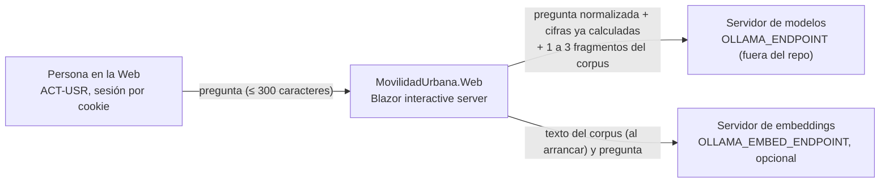
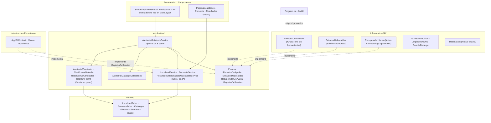

# Especificación del asistente integral de `MovilidadUrbana.Web` (arc42 reducido, K1)

Versión 0.2 · 2026-11-11 · estado: **implementada** (rama `feat/asistente-integral`; la evidencia está en [verificacion-2026-11-11.md](verificacion-2026-11-11.md)) · contexto de la capacidad: CTX-PROTO.
Insumos: los conocimientos K1 a K7 de la guía [Dot-Net-Integration-AI-Layer-Guide](https://github.com/hdcm-dev/Lab-Documentos/tree/main/Guides/IA/Dot-Net-Integration-AI-Layer-Guide) (`Conocimientos/`, en `b5c04c3`), un relevamiento previo del repositorio y [Guía cap. 15].
Repo anfitrión: `hdcm-dev/Lab-E2E.WebBlazor`, medido el 2026-11-11 con `git fetch && git rev-parse --short origin/main` → **`c6b60ce`** (PR #13).
El relevamiento citaba `59399ba` (PR #12): está una fusión atrás. El PR #13 es de CI (etiqueta del runner), así que no cambia el diseño, pero la base de los PR es `c6b60ce`.

Marcas: **[MEDIDO]** = lo corrí en esta sesión, con el comando al lado. **[INFORME]** = viene del relevamiento o del libro y no lo medí.
**[PROPUESTA]** = decisión de esta especificación, pendiente de firma.

---

## 0. Normas del repo anfitrión (paso 0, C-00)

| Norma | Fuente | Efecto en la especificación |
|---|---|---|
| Hay tres apps independientes que repiten sus capas y no se referencian entre sí | README «Estructura» [INFORME] | el asistente vive **entero** en `src/MovilidadUrbana.Web`. No referencia la demo de la guía, ni `ApiWeb`, ni `MAUI`; replica el patrón de la demo |
| La arquitectura va en inglés y el dominio en español | commits `946d023`, `e9dea2a` [INFORME] | `Infrastructure/AI/`, `Application/Asistente/`, sufijos `Service`, `Port`, `Tests` en inglés; tipos de dominio en español (`Destino`, `Anillo`, `Voto`, `RespuestaDelAsistente`) |
| El esquema se crea con `EnsureCreated`, **sin migraciones, a propósito** | `Infrastructure/Persistence/DatabaseInitializer.cs:10` [MEDIDO: `sed -n 1,30p`] | **choca con K2 §8.5** («la tabla de votos se crea por migración versionada»). Rige la norma del anfitrión (K4 §13): la tabla `Votos` entra en `AppDbContext` y se crea con `EnsureCreated`. Ver D-3 |
| Cada sesión ve sólo sus datos (cookie) | `Sessions/SessionMiddleware.cs`, `ISessionContext` [MEDIDO: `ls`] | la sesión es la unidad de aislamiento (equivale al inquilino de R-01) |
| Las rutas `@page` son `/`, `/localidades`, `/encuesta`, `/encuesta/{Paso:int}`, `/no-encontrado` y `/Error` | [MEDIDO: `grep -rn '@page'`] | son el universo del catálogo de destinos y de la cobertura |
| Hoy ninguna página lee `[SupplyParameterFromQuery]` | [MEDIDO: `grep -rln SupplyParameterFromQuery` → vacío] | todo deeplink que abra una acción es código de producto nuevo (E-2 de K2 §16) |
| Un paso de la encuesta pedido por URL no puede saltear los anteriores | `Encuesta.razor.cs:66-76`, `Math.Min(request, _pasoMaximoAlcanzado)` [MEDIDO] | `/encuesta/2` y `/encuesta/3` **no** son destinos de acción: en una visita nueva abren el paso 1. El relevamiento (§3) los daba por «destino fácil»; se corrige |
| `LocalidadRules.NombreValido` aplica sólo el mínimo (3); el máximo de 60 está declarado y no se aplica. `ProvinciaValida` no mira `Catalogos`. `\d{4}` acepta dígitos Unicode | `Domain/Rules/LocalidadRules.cs:11-35` [MEDIDO] | la misma deuda que [Guía §15.1] corrigió en la demo. Endurecerla es «modificado a causa de la IA» (la propuesta del extractor pasa por estas reglas). Va en la E6 |

**Términos nuevos que hay que proponer al glosario del repo** (no los tiene): capa de IA, puerto, adaptador, escalón de conocimiento, nivel de agencia, anillo, frontera de competencia, destino, deeplink, forma de respuesta (F1–F8), validador de cifras, habilitación, huella del turno, voto, batería, oráculo, línea base y degradado.

## 1. Introducción y metas (arc42 §1)

### 1.1 Las cuatro preguntas (C-01)

1. **¿Qué hace hoy la persona y por qué un modelo lo mejoraría?** La encuestadora busca en tres pantallas cómo cargar o por qué el formulario no la deja seguir. El analista **no tiene pantalla**: no puede saber qué medio domina ni cuántas encuestas hay por motivo. El alumno no entiende «sesión», «multirrespuesta» ni «único por provincia». Un modelo mejora una sola cosa: **redactar** en lenguaje llano una explicación anclada en los 12 requisitos y en el glosario, y entender preguntas escritas con palabras propias («¿cuántos van en bondi?»). Las cifras y los destinos no los mejora: salen de código.
2. **¿Alcanza una regla?** **En parte.** El ruteo, los sinónimos, las cifras, la forma del gráfico, la aclaración y el rechazo son reglas. La redacción de la ayuda tiene respaldo: la **plantilla** con el requisito literal de `*Policy`, que es la línea base.
3. **¿Qué cuesta un error y quién lo absorbe?** Lo caro es una cifra inventada o un dato personal (nombre o edad) en una respuesta: el alumno aprende un dato falso o ve datos de una persona. Lo absorbe el lector, y no se compensa con aciertos. Un falso «No está en la ayuda» es barato, porque la persona sigue con el destino.
4. **¿Con qué métrica y qué umbral se decide seguir?** Batería ×3 con M ≥ 20, mínimo de las tres corridas ≥ 90 %, cero datos inventados y crítico ≥ 8 (K3 R2.5, R4.2). Además, la redacción con modelo **no peor que la plantilla** en la lectura humana (claridad), sobre los mismos casos. Fija el umbral ACT-ARQ (el PO). **Pendiente de firma.**

### 1.2 Resultado del árbol (C-02)

| Capacidad | Rama del árbol | Escalón de conocimiento | Nivel de agencia | Patrón de salida |
|---|---|---|---|---|
| CAP-1 Cifras de la sesión («¿cuántas…?», «¿qué medio…?») | dato exacto pedido en lenguaje libre → **A1 lectura**, pero con el **código** eligiendo la herramienta (ARQ-1) | carril aparte | A1 lectura (las funciones existen; las invoca el enrutador, no el modelo) | texto que afirma datos → anclaje (REQ-IA-22) |
| CAP-1b Pantalla `/resultados` (el hueco del analista) | **escalón −1**: una pantalla de agregados alcanza (K1 §1: «si una pantalla de filtros alcanza, es −1 aunque todavía no exista») | −1 | — | — |
| CAP-2 Ayuda para operar y glosario | en parte → la plantilla queda de respaldo | **K1 contexto completo** del corpus del anillo (ver ADR-CONOCIMIENTO) con compuerta léxica | A0 | texto que afirma datos → anclaje, y cita por oración |
| CAP-3 Destinos (chip que abre la acción) | regla → −1 | −1 | — | — |
| CAP-4 Aclaración, rechazo y abstención | regla → −1 | −1 | — | texto fijo |
| CAP-5 Alta de una localidad desde una frase (PD-3 en la Web) | en parte (el formulario es el respaldo) | K0 | **A0 con persona que firma**: el modal prellenado lo confirma la persona | estructurada (REQ-IA-03) |
| CAP-6 Baja de una localidad desde una frase | regla → −1 (resolver nombre y provincia en la sesión) | −1 | — (el chip abre el diálogo de confirmación existente) | — |
| CAP-7 Votos y medición | regla → −1 | −1 | — | — |

**Decisión central [PROPUESTA]:** en la Web el asistente **no escribe**. CAP-5 y CAP-6 no usan `ApprovalRequiredAIFunction` (PD-5 y PD-6 de la demo): llevan a la acción **abierta y prellenada** en la pantalla, y la persona confirma con el control que ya existe. Hay tres razones. CD-6 de K5 («el asistente no actúa ni dice que actúa»). K2 §1 (la consola cubre lectura y navegación; escribir pide otra mesa). Y la regla de las tres apps independientes, porque no se copia el `ResolutorDeAprobaciones`. Esto **no contradice** [Guía §15.3]: la demo enseña la aprobación en un host de chat; la Web enseña el otro patrón válido del libro (A0 con persona que firma). La aprobación en el chat queda como diferido D-1, con su mesa propia.

### 1.3 Escenarios, contextos y actores (C-03)

- **ESC-01** asistente sobre datos propios (CAP-1, 2, 4). **ESC-03** extracción estructurada (CAP-5). ESC-02, ESC-04 y ESC-05 **no aplican**: no hay búsqueda semántica expuesta, el modelo no elige herramientas y no hay MCP.
- **CTX-LOCAL** (servidor de modelos de la organización, por variable de entorno) · **CTX-PROTO** · **CTX-SENS** (la encuesta guarda nombre y edad: los datos son sintéticos, pero el *tipo* de dato es personal) · **CTX-EXISTENTE**.
- **Actores.** ACT-ARQ = el PO (umbral, ADR). ACT-SEC = el PO (datos al modelo, C-13). ACT-DEV = el agente implementador. ACT-OPS = quien corre el contenedor. ACT-USR = las cinco personas de la matriz de §8.2.

### 1.4 Inventario de capacidades

CAP-1 a CAP-7 en el orden de la tabla 1.2, todas en estado **especificada**. Hay además dos capacidades de **sólo diseño**. CAP-8: escritura con aprobación en el chat (D-1). CAP-9: el asistente en `MAUI` y en `ApiWeb` (D-2): cada app tendría su copia, según la regla del repo.

## 2. Frontera de competencia (C-20, F-1 a F-8)

El **código** clasifica (`ClasificadorDeAnillo`, función pura). La duda cae a Afuera o al anillo 2, nunca al 1 (F-1).

| Anillo | Criterio de pertenencia (lo decide el código) | Conducta | Pieza que la sostiene | Qué no puede pasar | Formas |
|---|---|---|---|---|---|
| **1 · Operar** | intención reconocida de la tabla de intenciones del ABM, de la encuesta, de las cifras de la sesión o de la navegación («llevame a…») | pasos y cifras reales, con el chip que abre la acción | enrutador → funciones de lectura sobre casos de uso (carril aparte); destino por catálogo; CAP-5 y CAP-6 sin escritura | una cifra que no salió de una función; un destino fuera del catálogo; una escritura | F1, F2, F3, F4, F6 |
| **2 · Entender el dominio** | el término normalizado está en el glosario (frecuencia, multirrespuesta, CP de 4 dígitos, sesión, siembra, único por provincia, promedio, mediana) | explicación corta y después el paso del anillo 1 | `Glosario` y `Sinonimos` versionados como datos; requisitos de `*Policy`; **sin funciones** (F-2) | una explicación sin cita a su entrada | F4, F5 |
| **3 · Lo de al lado** | intención de derivación: la API REST (Scalar), las pruebas E2E del repo, cómo leer un promedio con n chico, qué es una encuesta en general | orientar con cita y decir cómo se vuelve al producto (chip a la pantalla del producto) | fichas de derivación del corpus, con cita y **sin funciones** | inventar pasos de un sistema ajeno, o una URL de la API que el corpus no trae | F4, F5 |
| **Afuera** | todo lo no reconocido; horarios y recorridos reales de colectivos, clima, estadísticas oficiales, políticas de transporte, otras ciudades fuera del catálogo y tendencias | rechazo amable con 2 o 3 preguntas de ejemplo que sí contesta | texto fijo del código, **sin llamada al modelo** | una respuesta del modelo | F7 |

- **F-3:** los sinónimos se aplican antes de clasificar y antes de buscar (tabla §8.1 de `catalogo-destinos.md`).
- **F-4 y F-5:** el umbral de la compuerta léxica y el evento de campos cerrados se aplican como están en el conocimiento.
- **F-6:** la frontera crece con datos versionados, nunca con el prompt.
- **F-7 (riesgo profesional) no aplica:** el dominio no es clínico, legal ni financiero. El motivo «salud» de la encuesta es una categoría de viaje, no un dato clínico; la pregunta «¿me conviene ir al hospital en bici?» va a Afuera de todos modos.
- **F-8 no aplica en sentido estricto:** no hay categorías especiales. Sí rige R-02 por CTX-SENS: al modelo no viajan `Nombre`, `Edad` ni texto escrito por terceros.

**Corrección del relevamiento:** su §8 ponía las **cifras** en el anillo 2. Por F-2, sólo el anillo 1 lleva funciones, y las cifras salen de funciones. Por eso las cifras van al **anillo 1**. El anillo 2 explica qué significa la cifra (multirrespuesta, n chico), sin calcularla.

## 3. Contexto y alcance (arc42 §3; C-13, C-15, C-16)

- **Datos mínimos que salen (C-13) [PROPUESTA, firma pendiente de ACT-SEC].** Al modelo de redacción viajan cuatro cosas: la pregunta normalizada (sin la cookie ni el id de sesión); las cifras agregadas que el enrutador ya calculó; los fragmentos del corpus; y la plantilla. **Nunca viajan** `Nombre` ni `Edad` de una respuesta, ni nombres de localidades cargados por la persona salvo el que la propia pregunta nombra. Los nombres cargados son texto de terceros (R-05): en las cifras se proyectan como `localidad #n` con su etiqueta sólo del lado de la pantalla. Al extractor de CAP-5 viaja sólo la frase. Al modelo de embeddings viajan el corpus (público) y la pregunta.
- **MCP:** no (C-15 NO APLICA: no hay cliente externo).
- **Clientes (§6 de K1):** NO APLICA. Es una aplicación renderizada en el servidor, y la capa y la página viven del mismo lado.

## 4. Vista de bloques (arc42 §5; C-05, C-06, C-07)

### 4.1 Correspondencia de capas (CTX-EXISTENTE)

| Capa de referencia | Carpeta real en `src/MovilidadUrbana.Web` | Cómo se comprueba la regla |
|---|---|---|
| Presentation | `Components/` (`Pages/`, `Shared/`, `Layout/`) | prueba de arquitectura por reflexión (`ArquitecturaTests`) |
| Application | `Application/` (`Localidades/`, `Encuestas/`, `Abstractions/`) + nuevo `Application/Asistente/` y `Application/Resultados/` | Application no referencia `Infrastructure` ni `Microsoft.Extensions.AI` (la prueba **nombra el SDK**) |
| Domain | `Domain/` (`Entities/`, `Rules/`, `Catalogos.cs`) | sin SDK de IA (REQ-IA-01) |
| Infrastructure/Persistence | `Infrastructure/Persistence/` | implementa los repositorios; nueva entidad `Voto` |
| Infrastructure/AI | **nuevo** `Infrastructure/AI/` | el único lugar, junto con `Program.cs`, donde aparece el SDK (REQ-IA-02) |
| Host | `Program.cs`, `Infrastructure/DependencyInjection.cs` | elige el proveedor (`AddAI`) |

Las capas son carpetas de un ensamblado, así que la regla la impone una prueba, no el compilador (ADR-CAPAS).

### 4.2 Contenedores

Ninguna flecha va de `Infrastructure/AI` a `Domain` ni a `Persistence` (C-06). `ValidadorDeCifras` y `LimpiadorDeUrls` son código puro. Se ubican en `Infrastructure/AI` porque operan sobre la salida del modelo, igual que `GarantiaNumerica` en la demo. *Validación mermaid:* los dos diagramas de este archivo se renderizaron sin error (C-05, ver la verificación).

### 4.3 Pipeline del turno (K2 §3, aplicado)

| # | Paso | En Movilidad Urbana | Si falla |
|---|---|---|---|
| 1 | Contexto de pantalla | la ruta actual (`/localidades`, `/encuesta/2`, `/resultados`) como chip quitable «Sobre: Localidades» | se ignora la pista |
| 2 | Alcance | siempre **la sesión** (lo pone `ISessionContext`, nunca una firma). Dentro de la sesión, la entidad nombrada: localidad, provincia o medio | candidatas → F3 (Corrientes: ¿la localidad o la provincia?) |
| 3 | Rol | sin autenticación: el rol efectivo es «sesión». La persona del §8.2 sólo cambia las sugerencias | — |
| 4 | Anillo e intención | `ClasificadorDeAnillo` + `Enrutador` sobre la pregunta ya normalizada por `Sinonimos` | entre dos anillos: pregunta cerrada con opciones |
| 5 | Función o recuperación | anillo 1 → función de lectura; anillo 2 o 3 → recuperación sobre el corpus con compuerta léxica | sin dato o bajo el umbral → F5 |
| 6 | Redacción | `IRedactorDeAyuda` con cifras + fragmentos + plantilla; **sin herramientas** | sin modelo → plantilla de respaldo por pertinencia (F8 + contenido) |
| 7 | Validación | `ValidadorDeCifras` (miles con `es-AR`, porcentajes y decimales, como `GarantiaNumerica`), `LimpiadorDeUrls`, control de primera persona de acción | texto fijo con las cifras del código |
| 8 | Destino | id del catálogo revalidado **en el turno** contra el estado de la sesión (ver ≠ hacer, §5 de `catalogo-destinos.md`) | sin destino |

### 4.4 Fichas del puerto (C-07)

| Campo | `IRedactorDeAyuda` | `IExtractorDeLocalidad` |
|---|---|---|
| Capacidad | redactar una respuesta corta, en voseo y en segunda persona, con una cita por oración, sobre cifras y fragmentos dados; K1 contexto completo (sólo los fragmentos elegidos); A0 | proponer `LocalidadPropuesta` (nombre, provincia, CP, habitantes, todos anulables) desde una frase; K0; A0 con persona que firma |
| Contrato | `Task<Resultado<TextoRedactado>> RedactarAsync(PedidoDeRedaccion, CancellationToken)` en `Application/Asistente/` | `Task<Resultado<LocalidadPropuesta>> ExtraerAsync(string frase, CancellationToken)` |
| Tres resultados | *ok* → pasa al validador. *degradado* (sin modelo, fuera de tiempo, ocupado) → plantilla. *rechazado* (cifra sin origen, URL, primera persona de acción, cita inválida) → plantilla, y se cuenta aparte | *ok* → `LocalidadRules` decide y el chip abre el modal prellenado. *degradado* → chip al modal vacío. *rechazado* (no JSON, o un número que no está en la frase) → chip al modal vacío con el requisito que falló |
| Firma (R-02) | `PedidoDeRedaccion { Intencion, Anillo, Pregunta (normalizada, ≤ 300), Cifras[] (valor, etiqueta, nota), Fragmentos[1..3] (id, texto ≤ 500), Plantilla }`: ni sesión, ni nombre, ni edad | la frase (≤ 300) |
| Adaptador | `Infrastructure/AI/RedactorConModelo.cs`; prompt fijo en `Infrastructure/AI/Prompts/redactor.v2.txt` | `Infrastructure/AI/ExtractorDeLocalidad.cs`, con normalizador a `Catalogos.Provincias` y descarte de los números que no están en el texto |
| Caso de uso | `AsistenteService.ResponderAsync` | `AsistenteService` (intención `localidad.alta.desde_frase`) |
| Registro | `Infrastructure/AI/DependencyInjection.cs` → `AddAI(configuration)` desde `Program.cs` | ídem |
| Regla de ubicación | `ArquitecturaTests.SdkDeIa_SoloEnInfrastructureAIyRaiz` | ídem |
| Doble | `ClienteDeChatGuionado : IChatClient` (registra `TodoLoEnviado()`) | ídem |

`IRecuperadorDeAyuda` no tiene prompt: es léxico, con embeddings opcionales. `IRegistroDeSenales` persiste votos y señales. Ninguno de los dos necesita ficha de puerto con prompt.

## 5. Conceptos transversales (arc42 §8; C-14, C-26)

- **Configuración (REQ-IA-31) [PROPUESTA].** Se usan los nombres del libro [Guía A.12], uno por dato: `OLLAMA_ENDPOINT`, `OLLAMA_MODEL`, `OLLAMA_EMBED_ENDPOINT`, `OLLAMA_EMBED_MODEL`, `OLLAMA_NUM_CTX` y `Asistente__Habilitado` (R-08; por defecto `true` en PROTO). **Sin valores por defecto en el código de la Web.** A.12 da `localhost` y un nombre de modelo por defecto para la demo, pero C-26 prohíbe un nombre de modelo en el repo. Se aplica K1, que es más estricto (K4 §13 admite endurecer), y el choque se anota para la mesa del libro. Los parámetros que no son secretos (umbral léxico, top-k = 3, tope de 300 caracteres, tiempo máximo de 20 s, concurrencia = 1) van en `appsettings.json`, sección `Asistente`.
- **Habilitación (REQ-IA-29).** Es un catálogo cerrado `MotivoDeHabilitacion { Habilitada, ApagadaPorParametro, FaltaEndpoint, FaltaModelo, ClaveDesconocida, SinRespuesta }`, más `SinEmbeddings` como **nota**, no como apagado. Se registra una vez al arrancar, nombrando la clave y nunca su valor. Lo exponen `/health/asistente` (JSON `{ motivo }`) y la cabecera del panel («La ayuda con IA está apagada: falta configurar OLLAMA_MODEL. Las cifras y los destinos siguen funcionando.»).
- **Degradación sin modelo.** Las cifras, los gráficos, los destinos, el glosario (texto fijo de la entrada), la aclaración, el rechazo y los votos funcionan sin modelo. Sólo la redacción cae a la plantilla con el fragmento pertinente.
- **Límites (REQ-IA-21).** Tope de 300 caracteres (lo que excede no viaja: F8 «Escribí una pregunta más corta»). Concurrencia 1 con un `ConcurrencyLimiter` singleton (como `LimitadorDelModelo`, sin copiarlo de la demo): la segunda consulta simultánea degrada a «ocupado». Sin reintentos y con tiempo máximo.
- **Rótulo de IA.** Toda burbuja redactada por el modelo lleva «Redactado con IA a partir de la ayuda» y sus citas. Las plantillas llevan «Respuesta fija».
- **Telemetría (REQ-IA-09).** Sin contenido fuera de `Development`. El registro guarda motivo, intención, anillo, forma, duración y correlación, nunca la pregunta.
- **Aislamiento (R-01 → sesión).** Las funciones se crean por pedido, cerradas sobre `ISessionContext`. Ninguna firma recibe la sesión (REQ-IA-06, K6 R2).

## 6. Decisiones (arc42 §9; C-08, C-09)

El repo no tiene registro de ADR. **Propuesta:** `docs/adr/` con numeración propia desde 0001.

| ADR | Decide | Alternativas descartadas | Deja de valer si | Firma |
|---|---|---|---|---|
| 0001 ADR-LLAMADA | puerto propio (`IRedactorDeAyuda`, `IExtractorDeLocalidad`) y **no** una sesión de chat con herramientas | sesión de chat con `UseFunctionInvocation` como la demo: descartada por ARQ-1 (el código elige) y por CD-6 | una intención pasa al modelo por K6 §9 (batería ×3 por los dos caminos) | pendiente |
| 0002 ADR-PROVEEDOR | `IChatClient` de Microsoft.Extensions.AI con el adaptador de Ollama, elegido en `AddAI`; CTX-LOCAL | nube: descartada por CTX-SENS y por el costo en un laboratorio | se pasa a CTX-NUBE | pendiente |
| 0003 ADR-CAPAS | carpetas del ensamblado con prueba de arquitectura que nombra el SDK | proyectos separados: rompería la forma del repo, que tiene un proyecto por app | se comparte la capa entre apps (prohibido hoy) | pendiente |
| 0004 ADR-HERRAMIENTAS | funciones de sólo lectura sobre casos de uso, cerradas sobre la sesión e invocadas **por el enrutador** | herramientas ofrecidas al modelo: no se descartan para siempre (K6 §9) | — | pendiente |
| 0005 ADR-AGENCIA | A1 lectura (enrutador) + A0 con persona que firma; **ninguna escritura** desde el asistente | A1 escritura con aprobación (PD-5 y PD-6): diferida D-1 | el PO pide escritura en el chat | pendiente |
| 0006 ADR-CONOCIMIENTO | K1 contexto completo de los fragmentos elegidos por una compuerta léxica + embeddings opcionales; el corpus entero mide < 15 páginas | K2 RAG vectorial puro: [Guía §15.3] dice que en PD-2 «sube de más» con 12 requisitos; sin compuerta: perdería F5 | el corpus pasa de unas 40 páginas o el recall@3 léxico < 0,9 | pendiente |
| 0007 ADR-VOTOS-SIN-MIGRACION | la tabla `Votos` con `EnsureCreated`, por la norma del repo | migración versionada (K2 §8.5) | el repo adopta migraciones | pendiente |

## 7. Requisitos de calidad (arc42 §10; C-10, C-11)

Columnas: Id · Requisito · PROTO · PROD · Criterio · Prueba · Tipo · Estado. Todas las filas pasaron a *implementada*; la columna «Prueba» nombra la prueba que las sostiene (en `tests/MovilidadUrbana.UnitTests`, salvo las de conducta, que mide la batería). G = garantía; C = conducta.

| Id | Requisito | PROTO | PROD | Criterio de aceptación | Prueba | Tipo |
|---|---|---|---|---|---|---|
| REQ-IA-01 | Domain sin SDK de IA | DEBE | DEBE | la prueba nombra `Microsoft.Extensions.AI` y falla si un tipo de `Domain` lo usa | `Domain_SinDependenciasDeIa` | G |
| REQ-IA-02 | SDK sólo en `Infrastructure/AI` y en la raíz | DEBE | DEBE | una mutación que lo viola da rojo | `SdkDeIa_SoloEnInfrastructureAIyRaiz` | G |
| REQ-IA-03 | El extractor consume sin excepción un formato inválido | DEBE | DEBE | texto no JSON → sin propuesta; chip al modal vacío | `Extractor_TextoNoJson_SinPropuesta` | G |
| REQ-IA-04 | Toda función envuelve un caso de uso | DEBE | DEBE | ninguna función depende de `ILocalidadRepository`, `IEncuestaRepository` ni `AppDbContext` | `Funciones_SinRepositorios` | G |
| REQ-IA-05, 07, 20 | Escrituras | — | — | conservan su criterio | NO APLICA: el asistente no tiene funciones de escritura (ADR 0005); lo vigila `Funciones_SoloLectura` | — |
| REQ-IA-06 | La sesión la pone el código | DEBE | DEBE | dos sesiones en paralelo no ven sus cifras | `DosSesionesEnParalelo_NoSeVen` | G |
| REQ-IA-08 | Tope del bucle | — | — | — | NO APLICA: no hay bucle de herramientas (el enrutador llama una vez) | — |
| REQ-IA-09 | Contenido fuera de las trazas salvo en `Development` | DEBE (CTX-SENS) | DEBE | los spans no traen mensajes | `ContenidoApagado_LosSpansNoTraenMensajes` | G |
| REQ-IA-10 | Agregados sin datos personales | DEBE | DEBE | ningún tipo alcanzable desde el retorno de `ResultadosDeEncuestaService` tiene `Nombre` ni `Edad` | `Resultados_SinDatosPersonales` | G |
| REQ-IA-11 | Registro de corrida recalculable | DEBERÍA | DEBE | recálculo del veredicto = 0 diferencias | `RecalcularOraculos` | G |
| REQ-IA-12 | Métrica k de M con rótulo | DEBE | DEBE | el informe trae k₁, k₂, k₃ /M, modelo (por variable), servidor, fecha, línea base (plantilla) | corrida rotulada `bateria.sh` | C |
| REQ-IA-14 | Valores afirmados anclados | DEBE | DEBE | el doble que inventa una cifra → *rechazado* | `ValorNoAnclado_Rechazado` | G |
| REQ-IA-15 | Al modelo viaja sólo lo declarado | DEBE | DEBE | `TodoLoEnviado()` no contiene cookie, id de sesión, `Nombre` ni `Edad` (canario «Persona Canario 99») | `Pedido_SoloCamposDeclarados` | G |
| REQ-IA-16 | Sin modelo → degradado y sigue | DEBE | DEBE | con el doble que no responde: cifra y destino presentes, plantilla | `SinModelo_CifraYDestinoSiguen` | G |
| REQ-IA-17 | Nace apagable | DEBE | DEBE | `Asistente__Habilitado=false` → sin panel; las 22 E2E y las 49 unitarias previas en verde, sin cambios | `Apagado_ComportamientoPrevio` + suite previa | G |
| REQ-IA-18 | Inquilino por código | DEBE | DEBE | localidad de otra sesión → «no encontrado» (cifra, candidata y deeplink `?baja=`) | `LocalidadDeOtraSesion_NoEncontrada` | G |
| REQ-IA-19 | Texto de terceros marcado | DEBE | DEBE | el nombre de localidad cargado con instrucciones ([Guía §12.7]) no viaja sin marca | `LocalidadConInstrucciones_NoViajaSinMarca` | G |
| REQ-IA-21 | Largo, concurrencia, sin reintentos | DEBE | DEBE | 301 caracteres → sin llamada; doble que falla → una sola llamada; segunda simultánea → «ocupado» | `TextoSobreElTope_SinLlamada`; `Concurrencia_SegundaDegrada` | G |
| REQ-IA-22 | Validador de cifras con caída a texto fijo | DEBE | DEBE | doble que dice «hay 7 localidades» con 2 → texto fijo con 2 y evento *rechazado* | `CifraSinOrigen_TextoFijoConCifrasDelCodigo` | G |
| REQ-IA-23 | Alcance y aclaración | DEBE | DEBE | «¿cuántas hay en Corrientes?» con la siembra → F3 (localidad o provincia), sin redacción | `Corrientes_AclaracionLocalidadOProvincia` | G |
| REQ-IA-24 | Ruteo determinista; redacción sin herramientas | DEBE | DEBE | tabla de 40 o más preguntas → intención esperada; `ChatOptions.Tools` vacío | `Ruteo_TablaDeReferencia`; `Redaccion_SinHerramientas` | G |
| REQ-IA-25 | Cobertura pantalla → ayuda | DEBE | DEBE | 4 de 4 `@page` del anillo 1 (`/`, `/localidades`, `/encuesta`, `/resultados`) con ficha `vigente`; umbral 100 % | `CoberturaDelCorpus_SobreUmbral` | G |
| REQ-IA-26 | Filtro de rol antes del top-k | — | — | conserva su criterio | NO APLICA: un solo rol efectivo (sesión anónima). El filtro por **estado** (`vigente`) sí va antes del top-k: `Borrador_NoEsCandidato` | — |
| REQ-IA-27 | Destino por catálogo; URL libre eliminada | DEBE | DEBE | doble con `[x](/admin)` → texto sin enlace; «llevame a /admin» → sin destino | `UrlLibre_SeElimina`; `RutaLiteral_SinDestino` | G |
| REQ-IA-28 | Ver ≠ hacer | DEBE | DEBE | sin localidades en la sesión, «quiero cargar una encuesta» → F6 «primero cargá una localidad» + chip `localidades.alta`, nunca `encuesta.inicio` | `EncuestaSinLocalidades_NegativaUtil` | G |
| REQ-IA-29 | Habilitación con motivo exacto | DEBE | DEBE | sin `OLLAMA_MODEL` → `/health/asistente` = `FaltaModelo`; el log no contiene el endpoint | `SinModelo_MotivoExacto_SinDireccion` | G |
| REQ-IA-30 | Voto sin texto ni persona | DEBE | DEBE | el tipo `Voto` sólo tiene campos cerrados; se lee desde la tabla | `Voto_SinTextoNiPersona`; `Voto_SePersisteYSeLee` | G |
| REQ-IA-31 | Una clave por dato, desde el entorno | DEBE | DEBE | con `OLLAMA_MODELO` (variante) → `ClaveDesconocida` nombrando la clave | `ClaveVariante_MotivoClaveDesconocida`; `Repo_SinModeloNiEndpoint` | G |
| REQ-IA-32 | Consola por rol | DEBE | DEBE | por cada persona de §8.2, una sugerencia propia → respuesta no vacía con destino permitido | `ConsolaPorPersona_{Persona}` | G |
| REQ-IA-33 | «No está en la ayuda» fijo | DEBE | DEBE | «¿cómo exporto a Excel?» → plantilla F5; el doble no recibe pedido | `SinFragmento_NoEstaEnLaAyuda` | G |
| REQ-IA-40 | Regla de forma de los datos | DEBE | DEBE | tabla `(tipo, n) → forma`: número → F1; respuesta única con 2 a 6 categorías → torta + tabla; multirrespuesta o más de 6 → barras ordenadas; comparación con varias columnas → tabla. **Medios nunca en torta** | `ReglaDeForma_Tabla`; `Medios_NuncaTorta` | G |
| REQ-IA-41 | Porciones exactas | DEBE | DEBE | propiedad: Σ porciones = total devuelto | `Porciones_SumanElTotal` | G |
| REQ-IA-42 | Nota de métrica | DEBE | DEBE | toda F1 o F2 o gráfico lleva la nota («de tu sesión, n = 20 respuestas; un encuestado puede marcar varios medios») | `CifraSinNota_NoSeArma` | G |
| REQ-IA-43 | n chico | DEBE | DEBE | n < 5 → la cifra sale con la advertencia fija; n = 0 → «Todavía no hay encuestas en tu sesión» + chip `encuesta.inicio` (si hay localidades) | `NChico_Advertencia`; `SinEncuestas_F5ConDestino` | G |
| REQ-IA-44 | Sinónimos y fuera de catálogo | DEBE | DEBE | bondi, micro y ómnibus → `colectivo`; laburo → `trabajo`; «subte», «avión», «taxi» y «remís» → aclaración «no está entre los 6 medios», nunca una cifra | `Sinonimos_Tabla`; `MedioFueraDeCatalogo_NoInventa` | G |
| REQ-IA-45 | El deeplink abre la acción | DEBE | DEBE | `/localidades?alta=1` abre el modal una sola vez; `?alta=1&nombre=Goya&provincia=corrientes&cp=3450` lo abre prellenado y la regla marca lo que falta; `?baja={id}` abre el diálogo sólo si el id es de la sesión | bUnit `Localidades_AltaPorQuery_*`, `Localidades_BajaPorQuery_*` | G |
| REQ-IA-46 | Latencia | DEBE | DEBE | p95 en caliente ≤ 8 s hasta la primera palabra; las cifras sin modelo ≤ 300 ms (techo: lo que tarda hoy abrir `/localidades` y contar a ojo; K3 R10.2a) **[pendiente de firma]** | registro de la batería | C |
| REQ-IA-47 | Redacción no peor que la plantilla | DEBERÍA | DEBE | lectura humana a ciegas: «más clara» ≥ «menos clara» sobre los casos F4 | lectura de §5 de `plan-verificacion.md` | C |

Verificador a mano (salida 0): 33 filas; Id único con dos dígitos o más: sí; criterio no vacío: 33 de 33; prueba o NO APLICA con motivo: 33 de 33. Las filas REQ-IA-05, 07 y 20 están agrupadas: en el archivo final van en tres filas.

## 8. Matriz de personas y riesgos (arc42 §8 y §11)

### 8.1 OWASP (C-12)

| Riesgo | Activo por | Control | Requisito |
|---|---|---|---|
| LLM01 Prompt Injection | A0 | procedencia; la redacción sin herramientas; destino por catálogo; texto de terceros marcado | 19, 24, 27 |
| LLM02 Sensitive Information Disclosure | A0 + CTX-SENS | agregados; entrada mínima; trazas sin contenido | 09, 10, 15 |
| LLM05 Improper Output Handling | A0 | validador de cifras, limpiador de URLs, extractor seguro | 03, 22, 27 |
| LLM06 Excessive Agency | A1 | sólo lectura; ninguna escritura | 04 (05/07/20 NO APLICA) |
| LLM08 Vector and Embedding Weaknesses | K2 opcional | filtro de estado antes del top-k; corpus público | 26 NO APLICA por rol; `Borrador_NoEsCandidato` |
| LLM09 Misinformation | A0 que afirma | anclaje + cita validada + lectura humana | 14, 22, 33 |
| LLM10 Unbounded Consumption | A0 | largo, concurrencia, tiempo máximo | 21 |
| ASI02 Tool Misuse | A1 | ruteo determinista, catálogo | 24, 27, 28 |
| ASI03 Identity and Privilege Abuse | A1 | sesión por código | 06, 18 |
| ASI09 Human-Agent Trust | A0 con persona que firma (CAP-5) | el modal muestra lo que propuso el modelo y lo que la regla rechazó, con el rótulo «Propuesto por IA, revisá antes de guardar» | REQ-IA-45 |

**Excluidos con motivo.** LLM03 y LLM04 (no se entrena ni se ajusta un modelo). LLM07 (el prompt de sistema no tiene secretos y es público en el repo).

**Ficha de riesgo de CAP-1/2.** Entrada no confiable: los nombres de localidad cargados por la persona y la pregunta. Efecto si el modelo obedece: un texto engañoso, nunca una acción. Control: sin herramientas, cifras validadas, URLs quitadas. Lo que no cubre (R-04): una paráfrasis engañosa sin números ni URL. Va a la lectura humana.

### 8.2 Personas (REQ-IA-32; equivalen a los roles de K2 §9, sin permisos distintos)

| Persona | Pantalla habitual | Sugerencias propias (todas realizables en la sesión) | Destinos |
|---|---|---|---|
| Encuestador/operador (la más privilegiada: la que da altas y bajas, por eso equivale al «raíz» de R7.2) | `/localidades` | «¿Cómo doy de alta una localidad?», «¿Por qué no me acepta el código postal?», «Borrá Resistencia» | `localidades.lista`, `localidades.alta`, `localidades.baja` |
| Persona encuestada | `/encuesta` | «¿Qué cuenta como frecuencia semanal?», «¿Puedo marcar dos medios?» | `encuesta.inicio` |
| Analista/lector | `/resultados` (nueva) | «¿Qué medio usa más la gente?», «¿Cuántas encuestas hay por motivo?» | `resultados.medios`, `resultados.motivos` |
| Integrador | `/` | «¿Cómo cargo una localidad por la API?» | anillo 3, sin chip externo; chip de vuelta a `localidades.lista` |
| Alumno | cualquiera | «¿Qué es una sesión?», «¿Por qué no veo lo de mi compañero?» | `inicio` |

## 9. Checklist K1 §12 (columna PROTO)

| # | Estado | Dónde |
|---|---|---|
| C-00 | SÍ (pendiente de firma): normas leídas y términos propuestos | §0 |
| C-01 | SÍ | §1.1 |
| C-02 | SÍ, «en parte», con el respaldo nombrado (plantilla) | §1.2 |
| C-03 | SÍ | §1.3, §1.4 |
| C-04 | SÍ | §1.2 |
| C-05 | SÍ: los diagramas se validaron renderizándolos | §4 |
| C-06 | SÍ | §4.2 |
| C-07 | SÍ | §4.4 |
| C-08 | SÍ, pendiente de firma | §6 |
| C-09 | SÍ, pendiente de firma | §6 |
| C-10 | SÍ (tabla a mano, 0 incompletas) | §7 |
| C-11 | SÍ | §7 |
| C-12 | SÍ | §8.1 |
| C-13 | SÍ, pendiente de firma de ACT-SEC | §3 |
| C-14 | SÍ por diseño; se mide con la búsqueda de secretos en cada PR | §5 |
| C-15 | NO APLICA (sin MCP) | §3 |
| C-16 | NO APLICA (app de servidor) | §3 |
| C-17 | SÍ, pendiente de firma: métrica k/M con M ≥ 20, umbral 90 % sobre el mínimo, error caro = cifra inventada o PII, línea base = plantilla | §1.1 |
| C-18 | SÍ: la sesión como inquilino | REQ-IA-18 |
| C-19 | SÍ: el validador mide números, horas e ids, y no ve paráfrasis | §8.1 |
| C-20 a C-27 | SÍ (C-23 sólo por estado; el rol NO APLICA) | §2, §7 |

**Criterio de parada K1 §11.1.** Con C-00 a C-27 en SÍ o NO APLICA, la especificación está **completa para PROTO**. Los ítems de decisión C-02, C-08, C-13 y C-17 quedan **pendientes de firma**: se elevan al PO en un solo mensaje con la propuesta (D-1 de K4).
