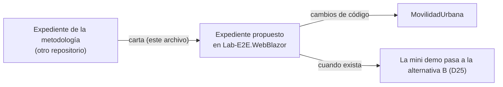

# Propuesta de expediente — cambios de código para documentar desde el código

## Índice

1. [Propósito](#1-propósito)
2. [Definiciones](#2-definiciones)
3. [Insumo: el defecto H-L07](#3-insumo-el-defecto-h-l07)
4. [Cambios propuestos](#4-cambios-propuestos)
5. [Qué no hace esta carta](#5-qué-no-hace-esta-carta)
6. [Efecto sobre la mini demo](#6-efecto-sobre-la-mini-demo)
7. [Criterios de aceptación del expediente propuesto](#7-criterios-de-aceptación-del-expediente-propuesto)
8. [Delegación del merge](#8-delegación-del-merge)

## 1. Propósito

Esta carta propone abrir en este repositorio un expediente para los cambios de código que la metodología de
documentación desde el código necesita y que el expediente que la originó **no puede hacer**: aquel expediente vive en
otro repositorio y tiene prohibido tocar el código de este. La carta es el insumo del expediente; no lo abre ni cambia
nada del código. El responsable del producto aprobó proponerlo (fila L7: «sí»).

## 2. Definiciones

| Término | Significado |
| --- | --- |
| Expediente | Carpeta numerada donde se trata un caso con sus folios, decisiones y evidencia |
| D19 | Decisión del expediente de origen: el contrato OpenAPI se emite en el build, se versiona y se vigila por diff; comentarios XML en la API y las bibliotecas; `CS1591` silenciado en aplicaciones y obligatorio en paquetes; MAUI fuera del primer escalón |
| D25 | Decisión del expediente de origen: la mini demo vive en `Examples/` de la guía, con el código de MovilidadUrbana fijado por SHA (`source.lock` en `8fb4c3a`); lo que haya que cambiar en el código va como propuesta a un expediente de este repositorio. Pasa a la alternativa B cuando ese expediente exista |
| D10 | Decisión del expediente de origen: trazas de la ficha al código como `ruta#Símbolo@SHA`; reglas sin ID llevan IDs provisionales `RN-LOC-nn` |
| Alternativa B (D25) | La demo deja de depender sólo de la extracción del contrato en ejecución y se apoya en el contrato que el propio repositorio emite y versiona |
| `source.lock` | Archivo de la demo que fija el SHA del código que documenta |

## 3. Insumo: el defecto H-L07

Al derivar la ayuda de la pantalla desde el código apareció un defecto de producto: **la pantalla promete un límite
que el comportamiento no cumple**. Es un caso real de que documentar es probar.

| Pieza | Qué dice (en `8fb4c3a`) |
| --- | --- |
| `src/MovilidadUrbana.MAUI/Domain/Rules/LocalidadRules.cs` | `LargoMaximoDelNombre = 60`, pero `NombreValido` sólo comprueba el mínimo |
| `src/MovilidadUrbana.MAUI/Application/Localidades/LocalidadPolicy.cs` | La ayuda dice «Entre 3 y 60 caracteres» |
| `src/MovilidadUrbana.MAUI/Pages/LocalidadEditorPage.xaml` | El campo `nombre` tiene `MaxLength="80"` |
| Ensayo del expediente de origen | `NombreValido(70 caracteres) = True`; SQLite guardó un nombre de largo 70 pese a `HasMaxLength(60)` |

**Ejemplo.** La persona escribe un nombre de 70 caracteres: la ayuda le dijo que el máximo es 60, el campo la deja
escribir hasta 80, la regla lo acepta y la base lo guarda.

Lo no verificado: la reproducción fue sobre la regla y la persistencia en contenedor, no en la pantalla de un
teléfono.

## 4. Cambios propuestos

| # | Cambio | Origen | Observable |
| --- | --- | --- | --- |
| C-1 | Aplicar el máximo de 60 en `NombreValido` (y alinear `MaxLength` del campo con `LargoMaximoDelNombre`) en Web, ApiWeb y MAUI | H-L07, D25 | Prueba unitaria: nombre de 61 caracteres es inválido; de 60, válido |
| C-2 | Emitir el contrato OpenAPI de la ApiWeb en el build (`Microsoft.Extensions.ApiDescription.Server` con `PrivateAssets=all` y `OpenApiDocumentsDirectory`), versionarlo y vigilarlo con `git diff --exit-code` en la CI | D19 | Un cambio de firma sin regenerar el contrato pone la CI en rojo |
| C-3 | Declarar el encabezado `X-Sesion-Id` en el contrato (transformador escrito siempre con lambda) **y** afirmarlo en una prueba | D19, D25 | La prueba falla si el encabezado desaparece del contrato; el diff no ve lo que el contrato nunca declaró |
| C-4 | Comentarios XML con el ID de la regla (`RN-LOC-nn`) en los símbolos que la implementan; `GenerateDocumentationFile` en API y bibliotecas, `CS1591` silenciado en aplicaciones y obligatorio en paquetes publicados | D19, D10 | Las fichas trazan `ruta#Símbolo@SHA` y el ID aparece en el XML generado |

MAUI queda fuera de C-2 a C-4 en este primer paso (D19); C-1 sí lo alcanza porque el defecto está en MAUI.

## 5. Qué no hace esta carta

- No modifica ningún archivo de `src/`, `tests/` ni de la CI.
- No abre el expediente: lo propone. Abrirlo, numerarlo y decidir su alcance corresponde al trámite de este
  repositorio.

## 6. Efecto sobre la mini demo

Mientras el expediente propuesto no exista, la mini demo sigue en `Examples/` de la guía, fijada a `8fb4c3a` por
`source.lock`, con el contrato extraído en ejecución. Cuando exista, D25 pasa a la alternativa B sin otra mesa: la
condición la fija el propio hecho.

## 7. Criterios de aceptación del expediente propuesto

- Dado un nombre de 61 caracteres, cuando se valida, entonces es inválido en las tres aplicaciones.
- Dado un cambio de firma en un controlador sin regenerar el contrato, cuando corre la CI, entonces falla.
- Dado el contrato emitido, cuando se lo inspecciona, entonces declara `X-Sesion-Id` y una prueba lo afirma.
- Dado un símbolo que implementa una regla, cuando se genera el XML, entonces contiene su `RN-LOC-nn`.

## 8. Delegación del merge

Esta carta entra por conformación automática del pull request (guarda G1–G4, merge atado al SHA). Testimonio del
responsable del producto, 2026-10-27: «esto surgió porque despues de un avance surgia preguntas y confirmaciones
tontas … Mi objetivo es que se enriquesca de tal forma el conocimiento analitico que los subagentes con este
conocimiento puedan orquestar de forma automatica todo el proceso de desarrollo». Vale para este primer merge del
repositorio. Excepción: si hay un cuestionamiento particular sobre la unidad, se para y se hace manual.
